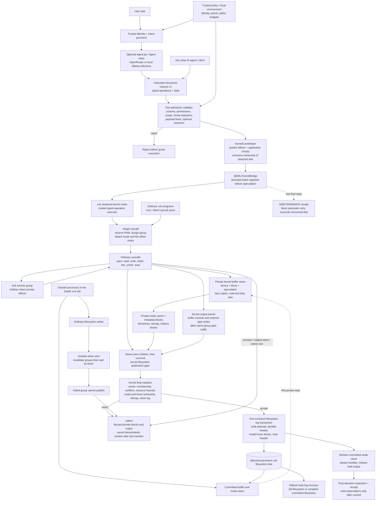

# SmashBash Agentic OS

**In-kernel externalization barriers for xv6 processes and their children.** Programs call `xbegin()`, execute ordinary filesystem operations in private kernel state, and request `xcommit()` or `xabort()`. The kernel isolates file data and metadata, and holds console and external pipe output until filesystem commit completes.

The Python LLM agent is optional. Any agent can submit the same structured format. The default agent and JSON CLI now use **kernel transactions on the attached persistent xv6 disk**. The earlier whole-image prototype is available explicitly with `--backend image`.

[Kernel design](docs/architecture.md) · [Corrections and evidence](docs/corrections.md) · [Agent setup](docs/agent.md) · [Wire protocol](docs/protocol.md) · [JSON schema](schema/request.schema.json)

## Complete architecture



The target is the filesystem disk attached to xv6. This does not translate writes into Windows folders, SQL databases or arbitrary external devices; those targets require separate adapters and transaction semantics.

## Build and run ordinary programs

Use Linux or Ubuntu WSL with Python 3.10+:

```sh
sudo apt-get install build-essential perl gcc-riscv64-linux-gnu binutils-riscv64-linux-gnu qemu-system-misc gdb-multiarch bc
make -C xv6 -j2 kernel/kernel fs.img
make -C xv6 CPUS=3 qemu
```

At the xv6 shell:

```text
spectest
xrun mkdir committed
xrun -n mkdir discarded
xrun echo visible-after-commit
xrun -n echo discarded-output
specbench
```

`xrun` joins its child and commits a successful command only if the kernel accepts the group. `-n` executes then aborts. A failed mutating syscall dooms its group even when a command exits zero. User programs can call the three syscalls directly; forked children inherit membership across `exec`.

Shell redirections performed before `xrun` starts are outside its transaction. Put such actions inside the program or shell controlled by `xrun` when they need the barrier.

## Submit a request or use the LLM agent

Initialize a new dedicated image once; `init` refuses to overwrite an existing target:

An old disk also contains old user binaries. Rebuilding only the kernel does not upgrade its `shadowd`. Use a newly initialized image for the kernel backend (choose a new filename when preserving an existing disk), or explicitly migrate the guest binaries and data first. The bridge rejects an old transport version before starting operations.

```sh
python3 -m smashbash init --image data/device.img --policy config/policy.example.json
python3 -m smashbash run --image data/device.img --policy config/policy.example.json \
  --principal local-user --request examples/write-and-read.json
```

The default backend attaches this persistent disk directly, without transaction snapshots or host replacement. Input acknowledgements mean ingestion only. Execution starts after the complete batch arrives; preview calls `xabort` inside xv6.

For the LLM client, copy `.env.example` to an ignored `.env` if needed, add your own provider key or configure a local Ollama model, then run:

```sh
python3 Agent.py --task "Write hello to note.txt" --plan-only
python3 Agent.py --task "Write hello to note.txt" --mode preview
python3 Agent.py --task "Write hello to note.txt" --mode commit
```

`Agent.py` starts `smashbash/agent.py`; `smashbash/llm.py` performs the provider HTTP request. The LLM proposes operations; trusted configuration selects identity, policy, target and mode. No key is bundled. Kernel verification requires no API key or LLM.

Typed operations are `fs.read`, `fs.list`, `fs.stat`, `fs.write`, `fs.append`, `fs.mkdir`, `fs.remove`, `fs.rename`. Ordinary programs can use the broader covered syscall surface through `xrun`.

## Rules and limits

| Rule | Behavior |
|---|---|
| Finalization | Only the begin owner finalizes; commit requires other members to have exited. |
| Nesting | Nested begin and invalid finalization return `-1`. |
| Conflicts | An ordinary writer invalidates active groups that read its changed block. |
| Owner abort/death | Discard effects and cancel descendants, retaining their private identity until cleanup. |
| Bounds | Four groups; 64 dirty blocks including metadata; 8192 output bytes; 64 output records; 32 tracked pipes per group. |
| Backing RAM | About 2 MiB reserved per group for the default 2000-block disk; blocks copied lazily. |
| Pipes | Internal traffic works before commit; external output is held; mixed inside/outside readers are rejected. |
| Concurrency | A sleeping kernel gate serializes filesystem syscalls and publication, excluding blocking pipe/console I/O and wait. |

Lazy first reads are not a globally frozen snapshot at begin. Block conflicts can conservatively reject unrelated edits sharing metadata. A 64 KiB write exceeds the default dirty budget once metadata is included and must abort safely. Existing images retain their original log capacity; the kernel clamps budgets to that capacity.

Abort does not rewind memory, consumed input or internal pipe reads. Filesystem durability precedes output release; a subsequent crash can lose output. Exactly-once output, arbitrary devices, network effects and a production security sandbox are outside the guarantee. Admission checks do not prove arbitrary requests harmless.

## Reproducible verification

```sh
python3 -m unittest discover -s tests -v
SMASHBASH_QEMU_TESTS=1 python3 -m unittest discover -s tests -v
python3 -m tools.verify_kernel --regression --bench
python3 -m tools.crash_kernel
```

Tests run ordinary concurrent processes in one VM on one and three CPUs. Crash tests stop real log code with GDB, kill QEMU before/after the commit header and during installation, then reboot and independently inspect both files and integrity. Benchmarks include safe overflow aborts and report raw guest ticks; zero ticks means below clock resolution. See [evidence and limits](docs/corrections.md).

A lost final reply is `INDETERMINATE` and blocks automatic retry until the recovered disk and receipt are reconciled. The redo log recovers filesystem state; it is not a durable request-ID ledger. Keep exclusive disk ownership and use one trusted state directory for all writers.

The optional [legacy image backend](docs/legacy-image-architecture.md) has a separate publication/recovery contract. Select it with `--backend image`; do not mix backends on an unresolved target.
