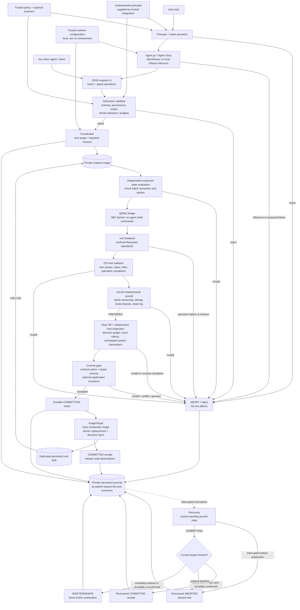
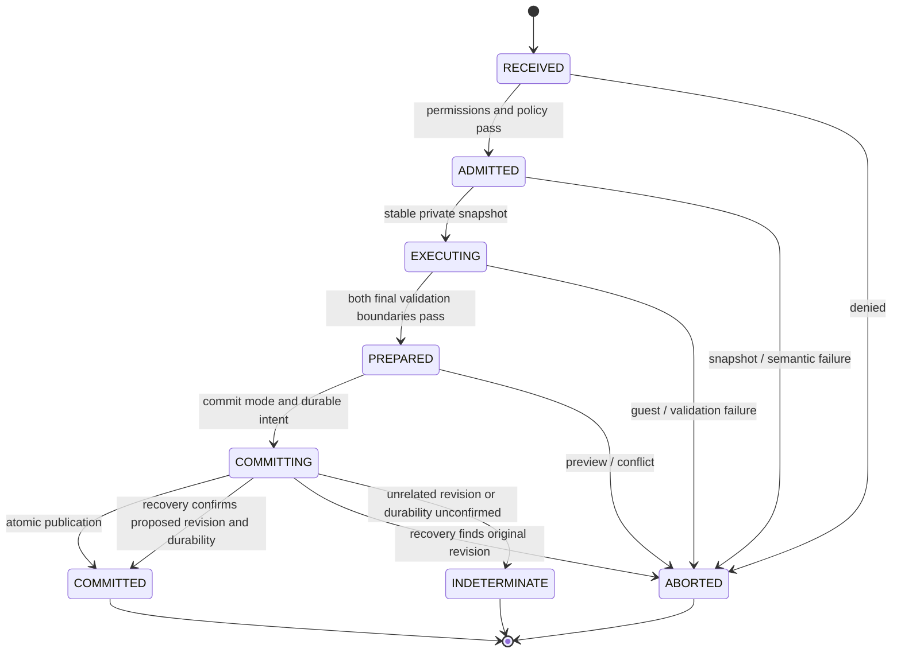

# SmashBash Agentic OS

An agent-independent transaction layer for xv6. An agent submits structured filesystem operations. SmashBash checks permissions and policy, executes the entire batch on a private QEMU disk, obtains an xv6 validation decision, independently inspects the resulting filesystem, and either publishes the new disk atomically or discards the trial.

**Implemented persistence target:** a dedicated xv6 filesystem image. It is the actual persistent block device attached to the OS, not a mock. Accepted changes survive subsequent QEMU boots. No live device is attached to a trial VM.

[Architecture and final validator criteria](docs/architecture.md) · [Agent protocol](docs/protocol.md) · [Security and recovery contract](docs/security.md) · [Request JSON Schema](schema/request.schema.json)

## Architecture

The complete implemented flow is shown below: the LLM-backed agent and other clients share the same validated OS protocol. Trials run on private xv6 disks, and publication requires both guest and host validation. Recovery resolves interrupted transactions from the journal.



### Transaction lifecycle



The persistent target is an xv6 filesystem image. Host-filesystem and database adapters remain unimplemented. See [validation criteria](docs/architecture.md#validation-criteria) and the [security contract](docs/security.md) for the exact guarantees.

## Build and run

The host package uses Python 3.10+ and the standard library. Build and run QEMU on Linux or WSL. On Ubuntu:

```sh
sudo apt-get update
sudo apt-get install -y build-essential perl gcc-riscv64-linux-gnu binutils-riscv64-linux-gnu qemu-system-misc bc
python3 -m smashbash build
python3 -m smashbash init --image data/device.img --policy config/policy.example.json
python3 -m smashbash run --image data/device.img --policy config/policy.example.json \
  --principal local-user --request examples/write-and-read.json
python3 -m smashbash inspect --image data/device.img --policy config/policy.example.json
```

Run commands from the repository root. `init` refuses to overwrite an existing image. The kernel and QEMU executable can be selected with `--kernel` and `--qemu`; there are no developer-specific executable paths. Building does not launch a VM against your persistent target.

Each `request_id` is used once per target. Repeating an identical request returns its recorded outcome without executing it again. Use a new ID for a new transaction. To validate and discard a trial, set the JSON request's `mode` to `preview`.

The sample policy grants `local-user` access to supported operations outside `secrets`, and grants `reader` read/stat access under `public`. A directory listing that overlaps a protected subtree is denied. Replace these example grants with your actual permissions before integrating an agent.

## Use the real LLM agent

`Agent.py` starts the LLM-backed `Agent` class in `smashbash/agent.py`. The actual provider HTTP invocation is in `smashbash/llm.py`. This is separate from the agent-neutral OS coordinator.

The workspace has an ignored `.env` with a blank key. For a new clone, copy `.env.example` to `.env` if it does not already exist, then add your own OpenRouter API key locally:

```dotenv
LLM_PROVIDER=openrouter
OPENROUTER_API_KEY=your-own-key-goes-here
LLM_MODEL=openrouter/free
LLM_BASE_URL=https://openrouter.ai/api/v1
OPENROUTER_FREE_ONLY=true
```

Create a key in your own [OpenRouter account](https://openrouter.ai/settings/keys). The [free router](https://openrouter.ai/collections/free-models) selects available free models; free usage is rate limited. Free-only mode rejects paid model IDs and the client supplies no paid fallback list. No third-party keys are bundled or obtained from public repositories.

```sh
# Invoke the LLM and validate the returned plan, without starting a VM.
python3 Agent.py --task "Write hello to note.txt" --plan-only

# Run the proposed batch in QEMU, validate it, and discard the trial.
python3 Agent.py --task "Write hello to note.txt" --mode preview

# Run and publish only if the full OS transaction pipeline accepts it.
python3 Agent.py --task "Write hello to note.txt" --mode commit

# Equivalent package entrypoint; omit --task for an interactive prompt.
python3 -m smashbash agent --task "Read note.txt" --mode commit
```

Preview is the default. Run QEMU commands in Linux/WSL after initializing the image above. Planning alone also works on Windows. A valid LLM plan is still untrusted: permissions, paths, schemas, budgets, guest validators, and the host commit gate all remain in force. The LLM cannot choose identity, targets, policy, or commit mode.

For an installed local Ollama model, change `LLM_PROVIDER`, `LLM_MODEL`, and `LLM_BASE_URL` to `ollama`, your model's installed name, and `http://127.0.0.1:11434/v1`. Local inference needs no API key and receives no OpenRouter authorization header. See [agent setup and limits](docs/agent.md).

## Agent integration

Agents provide JSON through stdin, a request file, or the Python API. They never choose the trusted principal, target image, kernel, permissions, or validator plugins inside the request.

```python
from pathlib import Path
from smashbash import Coordinator, ImageTarget, Policy, QEMUConfig
from smashbash.model import load_json

policy_path = Path("config/policy.example.json")
service = Coordinator(
    ImageTarget(Path("data/device.img"), Path(".smashbash")),
    lambda: Policy.load(policy_path),
    QEMUConfig(Path("xv6/kernel/kernel")),
)
request = load_json(Path("examples/write-and-read.json").read_bytes())
result = service.run(request, principal="local-user")  # Identity comes from your authentication layer.
```

For an LLM tool integration, expose the request schema as the tool input and bind `service` and the authenticated principal on the server. Supply the natural-language task in `intent`; the LLM's proposed typed operations are checked alongside that intent. The service itself does not depend on an LLM provider or API key.

Supported operations are `fs.read`, `fs.list`, `fs.stat`, `fs.write`, `fs.append`, `fs.mkdir`, `fs.remove`, and `fs.rename`. Data is base64 encoded and never executed. Paths are relative to the configured guest root. Rename is for regular files with an absent destination; removal of a directory requires it to be empty.

## Validation

1. Admission checks the strict schema, trusted identity, operation grants, path scope, protected paths, configured intent indicators, and payload budgets. Trusted applications can attach malware scanners or other admission checks.
2. xv6 enforces the bounded protocol, root confinement, file types, link restrictions, operation count, and file/tree quotas. Its final kernel check verifies allocation ownership, bitmap consistency, inode bounds, and a clean log.
3. The host checks the entire image, directory graph and link counts, exact expected changes, unchanged system files, guest report, current policy, and the live baseline. A mismatch aborts publication.

These checks enforce explicit safety rules. They do not determine whether every valid request is beneficial, or detect every possible malicious intent. See the security contract before extending the operation set.

## Tests

```sh
# Portable schema, policy, filesystem, image, concurrency, and recovery tests
python3 -m unittest discover -s tests -v

# Include real xv6/QEMU commit, abort, protocol, persistence, and corruption tests
SMASHBASH_QEMU_TESTS=1 python3 -m unittest discover -s tests -v
```

The second command requires the build above. Host tests also run on Windows. CI runs both host platforms and the real Linux/QEMU suite.

## Persistence and recovery

The service owns the image exclusively. Keep the same trusted `--state-dir` for every writer to that image. Do not attach it to a separate running VM or edit it outside the service. The service locks writers, captures a SHA-256 baseline, and rechecks it immediately before replacing the disk. An uncooperative writer cannot be made safe by a checksum alone.

The journal records validation states, request/policy digests, principal, revisions, and outcomes. File contents and raw intent text are not recorded there. Interrupted publication is resolved by comparing the target with its before/after revisions:

```sh
python3 -m smashbash recover --image data/device.img --policy config/policy.example.json
```

An ambiguous outcome becomes `INDETERMINATE` and blocks further commits; recovery never restores an old snapshot over someone else's changes. Read observations are released only after successful publication and are not replayed from the journal.

## Extending the system

- Register an agent by binding its authenticated principal to a policy grant; no xv6 changes are needed.
- Add trusted `AdmissionCheck` and `FinalCheck` implementations through `Coordinator`. `ContentHashDenylist` demonstrates a signature-based threat check.
- New executable operations require matching schema, expected-state evaluation, guest implementation, admission rules, and tests. Unknown operations always fail closed.
- `StorageTarget` defines the publication adapter contract. The included `ImageTarget` supports a dedicated xv6 disk. Host directories, raw devices, SQL databases, network calls, and cross-target transactions are not implemented. A database adapter must translate supported effects and use its database's native transaction and concurrency mechanisms; copying database files is not a valid adapter.

This implementation isolates whole trial VMs. It does not implement the earlier per-process `xbegin/xcommit/xabort` proposal in `problem understanding.md`, arbitrary shell command rollback, or rollback of external network effects.

## Repository layout

| Path | Responsibility |
| --- | --- |
| `smashbash/` | Public contract, policy, coordinator, QEMU bridge, image verifier, storage adapter |
| `xv6/user/shadowd.c` | Agent-neutral SB1 execution and final tree validator |
| `xv6/kernel/shadow.c` | Read-only kernel allocation/integrity validator |
| `config/`, `schema/`, `examples/` | Trusted policy example and agent-facing protocol |
| `tests/` | Portable checks, fault injection, and opt-in real VM integration |
| `agent/` | Compatibility entrypoint and imports; no mock dispatcher |
| `Agent.py`, `smashbash/agent.py`, `smashbash/llm.py` | Real task-to-operations LLM agent and provider client |
| `.env.example` | Blank, shareable configuration; actual `.env` is ignored |

The xv6 code retains its upstream license in `xv6/LICENSE`.
