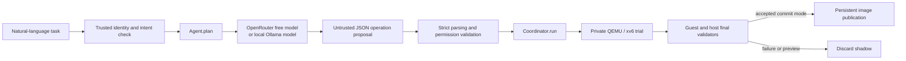

# LLM-backed agent

The OS transaction engine does not depend on an LLM. The optional `Agent` client now supplies the missing task-to-operations layer:



## Files and invocation

- `Agent.py`: convenient visible entrypoint.
- `smashbash/agent.py`: the `Agent` class, inference call, proposal validation, OS handoff, and CLI.
- `smashbash/llm.py`: real HTTP calls to the selected provider's `/chat/completions` endpoint.
- `smashbash/settings.py`: literal `.env` parsing, environment precedence, endpoint validation, and runtime settings.
- `.env`: private local configuration, ignored by Git; the checked-in `.env.example` contains no key.

The class supports dependency injection for tests; the normal CLI uses `LLMClient`, not the inference test doubles. No OpenAI API key or SDK is needed for OpenRouter or local Ollama.

## OpenRouter setup

1. Create/sign in to your own [OpenRouter account](https://openrouter.ai/settings/keys) and create an API key there.
2. Put that key in the local `.env` as `OPENROUTER_API_KEY`. Leave `LLM_MODEL=openrouter/free` and `OPENROUTER_FREE_ONLY=true` for free-only routing.
3. Run `python3 Agent.py --task "Write hello to note.txt" --plan-only` to test inference and plan validation.
4. After the xv6 image is initialized, use `--mode preview` or `--mode commit` to submit tasks to the OS pipeline.

`openrouter/free` chooses an available free model. Specific free variants generally end in `:free`. Availability and quotas can change; consult the [free model documentation](https://openrouter.ai/collections/free-models). A free model still needs your own account's API key. This repository does not contain a working key, create an account, or search for other people's credentials.

`LLM_RESPONSE_FORMAT=json_object` requests JSON mode. Set `json_schema` for a model supporting native structured outputs; `none` omits that API option but still requires strict local validation of the response. Unsupported options can produce a provider error; there is no automatic paid fallback or silent retry that consumes additional requests.

## Local Ollama setup

Install [Ollama](https://ollama.com/download), start its local server, and install a model suitable for your PC. `ollama list` shows installed model names. Use these settings:

```dotenv
LLM_PROVIDER=ollama
LLM_MODEL=your-installed-model
LLM_BASE_URL=http://127.0.0.1:11434/v1
```

Replace the model name with one actually installed. Use a model that follows JSON instructions; smaller models may produce invalid proposals, which are rejected. Model installation and local inference have not been performed by the environment-file setup. The [Ollama compatibility API](https://docs.ollama.com/api/openai-compatibility) supports local chat completions. This client sends no cloud key in local mode and permits only loopback HTTP endpoints for Ollama.

On Windows, `--plan-only` can talk to a Windows-hosted Ollama server. Run xv6/QEMU in WSL with an Ollama server reachable on that environment's loopback interface; Windows/WSL networking modes differ, so do not assume their `127.0.0.1` addresses always refer to the same server. The current client intentionally does not send local inference to an arbitrary remote host.

## Configuration

| Setting | Purpose |
| --- | --- |
| `LLM_PROVIDER` | `openrouter` or `ollama` |
| `OPENROUTER_API_KEY` | Your private key, required only for OpenRouter |
| `LLM_MODEL` | Free router/free variant, or an installed Ollama model |
| `LLM_BASE_URL` | Official OpenRouter API or loopback Ollama compatibility endpoint |
| `OPENROUTER_FREE_ONLY` | Blocks paid OpenRouter model IDs when true |
| `LLM_RESPONSE_FORMAT` | `json_object`, `json_schema`, or `none` |
| `LLM_TIMEOUT_SECONDS` | Inference timeout, 1–300 seconds |
| `LLM_MAX_TOKENS` | Output token budget, 256–16384 |
| `SMASHBASH_IMAGE`, `SMASHBASH_POLICY`, `SMASHBASH_STATE_DIR` | Trusted storage target, permissions, and journal |
| `SMASHBASH_KERNEL`, `SMASHBASH_QEMU`, `SMASHBASH_PRINCIPAL` | Trusted guest kernel, executable, and authenticated identity |

Environment variables override file settings. Relative runtime paths resolve from the env file's parent. The parser does not evaluate shell substitutions or expand variables, and error messages never include setting values. Keep `.env` and the process environment under trusted operator control. `.env.example` is safe to share because its key is empty.

## Execution and limits

The current agent makes one inference request for each user task and proposes one atomic batch. It does not run an unrestricted autonomous shell loop. The model emits only `operations` and `error`; trusted code constructs the transaction ID, original intent, and caller-selected mode. Refusal, malformed JSON, invalid base64, disallowed operations, or permission violations stop before OS execution.

The agent sends the task, allowed operation contract, path scopes, and budgets to the provider. It does not automatically upload existing files, `.env`, the key, or filesystem observations. Its single-batch design cannot invent file contents or perform conditional read-then-edit reasoning across multiple model turns. Tasks requiring such context must be supplied with the needed information or use a future explicit, permission-controlled observation loop.

Intent and principal checks run before inference; operation validation runs after inference and again in the coordinator. Organization-specific admission/final hooks still run in the coordinator. The LLM never decides whether a trial is safe to publish.

Preview runs the real trial and validators, then discards its shadow; read contents are not returned from preview trials. Commit mode is required to publish or obtain committed read observations. `--plan-only` invokes the model and validates its proposal without starting QEMU or requiring a device image. An interactive session treats each task as a separate transaction and does not silently send previous file observations back to the model.

Provider authentication/rate-limit failures, redirects, oversized responses, timeouts, truncated output, and unexpected tool calls stop the agent. Keys and provider error bodies are not logged. Automated tests cover the HTTP contract with test responses, plus an inference-double-to-real-QEMU integration test; a live external model test requires a user-supplied key or installed local model.
