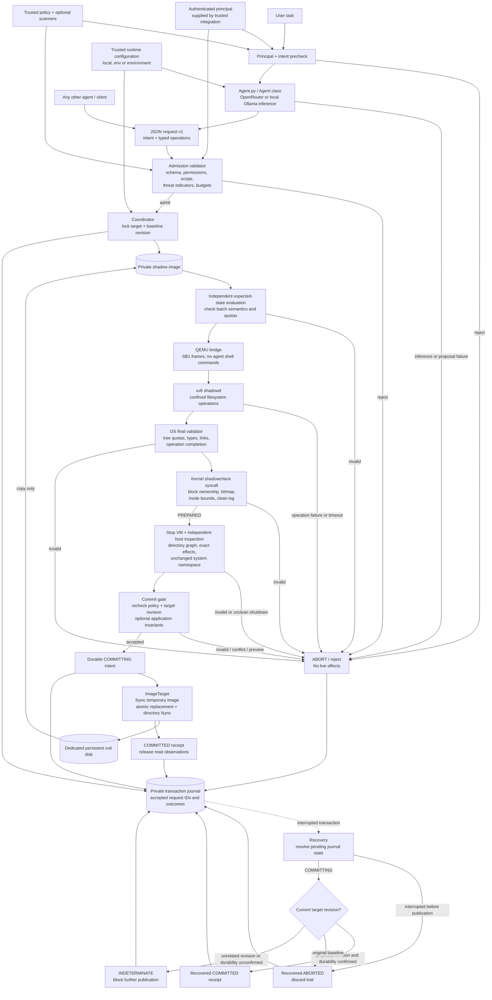
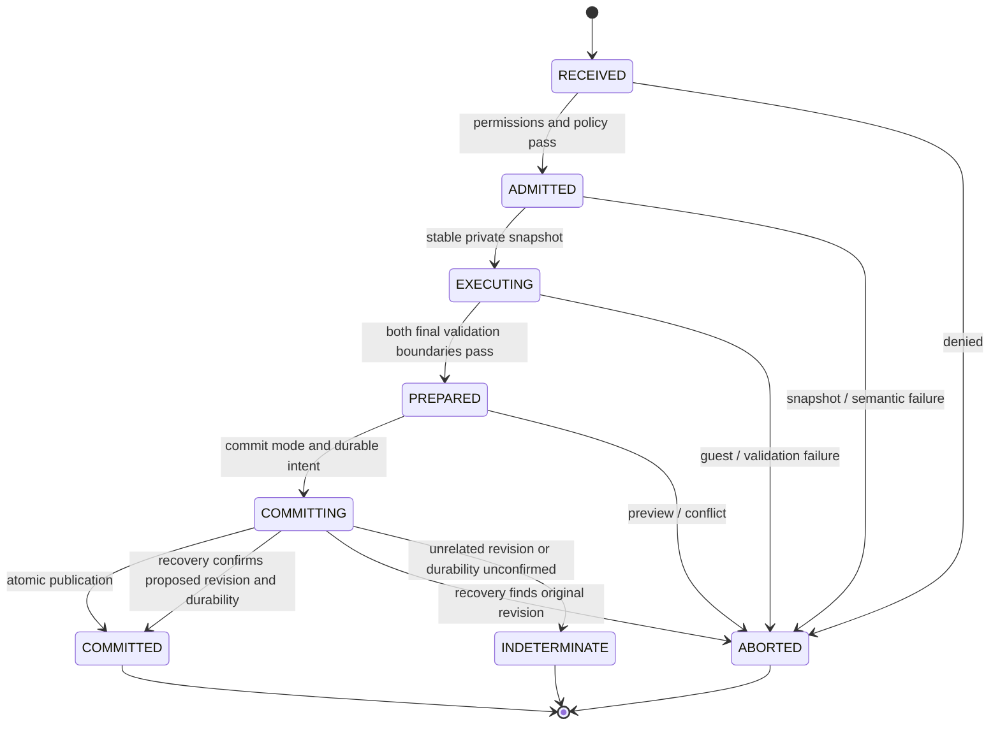

# Transaction architecture

The OS consumes a versioned operation protocol and knows nothing about an agent's vendor, framework, model, or prompting strategy. Trusted deployment code chooses the identity and capabilities. The agent proposes operations; neither its text nor its self-reported identity is an authority.

## Validation criteria

| Boundary | Criteria | Rejection behavior |
| --- | --- | --- |
| Admission | Version and exact fields; known operations; authenticated grant; path scope; protected subtrees; canonical paths; operation and payload limits; configured intent/signature scanners | No bridge is created |
| xv6 operation service | Strict frame sequencing; one active transaction; bounded payload; no shell execution; root confinement; successful syscalls; no devices or linked regular files; per-operation quota validation | Abort the entire private VM trial |
| OS final tree validator | All declared operations completed; no unfinished payload; managed namespace contains only regular files/directories; no repeated inode; bounded depth, entry count, file sizes, and total bytes; valid directory size/link counts | Never emits PREPARED |
| Kernel final validator | Valid superblock geometry; inode types/sizes/link viability; no data block out of range or shared between owners; exact allocation bitmap; empty log after sync | Never emits PREPARED |
| Host independent final validator | Full directory graph including dot links and reachability; file and directory reference counts; logical state equals the separately evaluated request; outside namespace unchanged; guest metrics match; optional trusted application invariants | Discard the shadow |
| Publication | Policy still current; permissions still valid; live baseline still identical; shadow digest verified while preparing replacement; durable commit intent exists | Conflict/abort, or explicit recovery if publication may already have happened |

## State machine

The filesystem log commits operations to the private disk during a trial. That is not publication to the live target. The external transaction commit is the host's atomic image replacement, after the VM has stopped. Abort discards the private disk rather than undoing mutations to a live filesystem.

## Agent and persistence independence

The Python `Coordinator.run` method is the common entrypoint. The included LLM-backed `Agent` invokes OpenRouter or local Ollama to propose a batch and submits it to that same method. Other CLI clients, LLM tools, queues, or a future authenticated server can also call it. There is deliberately no unauthenticated network listener or provider dependency in the OS execution path. See [the real agent setup](agent.md).

`StorageTarget` separates trial execution from native persistence. Its snapshot must yield a bootable private xv6 view. Its prospective revision must identify the proposed native result. Its publication method must enforce the baseline and atomically persist that result. Only `ImageTarget` ships here. Directory and database adapters must provide equivalent isolation, mapping, atomicity, and crash recovery before they can be enabled.

The earlier process-level speculation document is historical context. Whole-VM image isolation was chosen here to give xv6 trials a concrete externalization boundary without pretending that disk-block shadowing alone also isolates inode caches, unrelated processes, pipes, devices, or arbitrary host effects.
