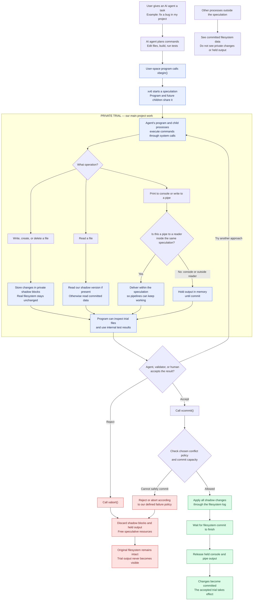

# Problem Understanding: Smash Bash

> Historical process-level proposal. The implemented agent-independent whole-VM transaction design is documented in [docs/architecture.md](docs/architecture.md). The `xbegin/xcommit/xabort` interfaces below remain a proposal and are not implemented by this repository.

## 1. What are we building?

We are extending the supplied xv6-riscv operating system so a process and its children can perform a private trial of file changes and output, then either keep those effects or discard them.

The assignment calls this **externalization barriers for speculative processes**.

In plain language:

**Try privately -> inspect and validate -> commit everything supported, or discard the trial.**

This document records our understanding and proposed implementation direction. It is not evidence that these features have already been implemented.

## 2. Why is this useful for agentic AI?

An AI agent chooses commands, executes them, examines results, and chooses its next action. Ordinary commands can change the world before the agent knows whether its plan was correct.

For example, an agent fixing a bug might edit the wrong file, delete something important, or leave a half-finished change that another process reads.

Our kernel mechanism gives covered actions a private trial period. A validator, controlling program, human, or agent can decide whether to keep the trial.

The OS enforces the barrier. A prompt saying "be careful" cannot provide this guarantee.

The mechanism does not judge correctness. Committing a bad change still keeps a bad change. Validation remains a separate responsibility.

## 3. Who does what, and where does it run?

| Component | Responsibility |
|---|---|
| User | Gives the task and acceptance criteria. |
| AI agent | Plans actions and decides how to evaluate their results. |
| xv6 user program or launcher | Starts speculation, runs commands, and requests commit or abort. |
| Children created after begin | Join their parent's speculation and contribute to the same trial. |
| xv6 kernel | Holds private file state and external output; enforces isolation and finalization. |
| Outside processes | Continue operating against committed filesystem state. |
| Our team | Implements, tests, measures, documents, and explains the kernel changes. |

The required deliverable is an xv6 kernel project and user-space demonstrations. A production LLM integration, web application, or real AI service is not a prerequisite.

## 4. What do the key terms mean?

| Term | Meaning |
|---|---|
| Speculation | A group of processes sharing a private trial of covered effects. |
| Externalization | An effect becomes observable outside the process group that produced it. |
| Barrier | Kernel logic preventing an effect from becoming externally visible too early. |
| Shadow block | A private copy of a filesystem block changed by a speculation. |
| Commit | Publish the filesystem changes safely, then release held output. |
| Abort | Discard private changes and held output and reclaim their resources. |
| Conflict | An outside process changes data also involved in a speculation under our chosen policy. |

Reading your own speculative write is allowed and is essential: the trial must behave like a usable filesystem from inside.

## 5. Is this a sandbox?

It has a sandbox-like purpose: isolated experimentation. More specifically, it adds transactional behavior to selected filesystem and output operations.

A general sandbox controls access and containment. This project controls when covered effects become visible and whether they are retained.

It is not a complete security sandbox, a virtual machine snapshot, or a rollback of arbitrary computation. Abort does not rewind CPU execution or automatically restore every process-memory change.

Email, payments, network APIs, arbitrary devices, and other real-world effects are outside the specified coverage unless additional mechanisms are built.

## 6. What exactly must the implementation do?

| Requirement | Expected behavior |
|---|---|
| Add xbegin() | Start a speculation and associate the calling process with it. |
| Inherit through fork() | Children created afterward share the speculation. |
| Add xcommit() | Finalize covered filesystem changes and then release held external output. |
| Add xabort() | Discard covered private effects and free associated resources. |
| Redirect writes | Modify private shadow state instead of committed filesystem blocks. |
| Read own writes | Participants see earlier speculative changes. |
| Isolate outside readers | Outside processes do not see uncommitted changes. |
| Support create and unlink | A speculative creation is private; a speculative deletion does not remove the outside version. |
| Buffer console output | Release only after filesystem commit finishes. |
| Handle pipes by reader membership | Hold output going outside the speculation; allow communication within it. |
| Define conflicts | Implement and demonstrate an explicit rule for concurrent outside changes. |
| Handle exhaustion | Fail safely when resources run out; never write real blocks as a fallback. |

Nested begin, invalid commit/abort calls, process exits, and concurrent participants need explicit semantics. The statement identifies nested begin as a hidden-test category but does not prescribe its result in the supplied excerpt.

## 7. End-to-end workflow example

The following is the exact Mermaid diagram from our discussion.



### How to read the diagram

The private region is the main implementation scope. The AI sits above ordinary user programs and system calls.

The diagram is conceptual: filesystem publication and subsequent console/pipe delivery are ordered, not one indivisible transaction across every medium. A crash after the filesystem commits can prevent held output from being delivered. Exactly-once external output across crashes is not established by this design.

An external AI cannot inspect held console output through the normal console before commit. We must define the integration protocol. A controller within the speculation can validate files and decide; an outside parent could potentially use a child's exit status if the lifecycle design supports it. We must not silently bypass the output barrier to expose trial logs.

## 8. Concrete file example: what changes and when?

Assume file a exists and file b contains "old".

A participant calls xbegin(), deletes a, writes "hi" into b, and prints "Done".

| Observation | During the trial | After abort | After successful commit |
|---|---|---|---|
| Participant reads a | Appears deleted | Original committed state is retained | Deleted |
| Outside process reads a | Still exists | Still exists | Deleted |
| Participant reads b | Sees "hi" | Trial changes discarded | Sees "hi" |
| Outside process reads b | Sees "old" | Sees "old" | Sees "hi" |
| Console | "Done" held | "Done" discarded | "Done" released after filesystem commit |

These examples assume no conflicting outside modification. Abort preserves outside changes too; it must not restore an old snapshot over somebody else's work.

Conceptual sequence, not complete executable C:

```text
xbegin()
    unlink("a")
    write "hi" into "b"
    print "Done"
    validate the private result
if accepted:
    xcommit()
else:
    xabort()
```

## 9. How do we plan to implement it?

### 9.1 Start with the actual supplied source

Read the syscall path, process lifecycle, buffer cache, filesystem, log, console, and pipes before choosing exact hooks. The handout snippets are skeletons, not drop-in working code.

The supplied tree differs from common tutorials:

- Kernel printing uses printk().
- Sleeping is split into preparation and sleep.
- Log constants are LOGBLOCKS = 30 and MAXOPBLOCKS = 10.
- copyin/copyout include the process size argument.
- kernel/defs.h is the authority for actual function prototypes.

First complete the handout's hello syscall exercise and verify sum = 10. This checks user declaration, generated stub, syscall number, dispatch, implementation, and Makefile UPROGS inclusion.

### 9.2 Represent speculation explicitly

Add a speculation identifier to struct proc and inherit it through fork(). A shared kernel object should track participants, shadow ownership, output queues, synchronization, and lifecycle state.

Proposed states: ACTIVE, COMMITTING, COMMITTED, ABORTING, ABORTED.

Define who may finalize the group, how participants stop changing it during finalization, and how exit/exec interact with membership. These are design decisions to settle before claiming full process-tree support.

### 9.3 Shadow blocks at the buffer cache

Recommended direction: maintain a fixed table of private copies keyed by speculation ID, device, and block number.

A participant reads its private version when one exists. Otherwise it reads committed data. A first modification creates a private copy; subsequent changes reuse it.

NSHADOW = 64 gives 64 KiB of block payload when BSIZE is 1024, plus metadata overhead. This is a starting configuration, not an unlimited capacity promise.

Intercepting bread() alone is insufficient: reads and writes, log_write(), buffer lifetime, locking, and error propagation must agree on which buffers are private.

Metadata blocks also need shadowing: inodes, directory entries, and allocation bitmaps. In-memory inode caches and allocation decisions must respect speculation too; shadowing disk blocks does not automatically isolate all cached state.

### 9.4 Hold external output

Console writes enter a bounded private queue.

Pipe handling must identify whether readers are inside or outside the same speculation. Merely asking whether the writer is speculative is insufficient. Reader membership, duplicated descriptors, fork, closed readers, queue exhaustion, and mixed readers require defined behavior.

Do not hold internal pipe traffic until commit: doing so can deadlock ordinary pipelines.

### 9.5 Commit safely

Before commit, stabilize participants, validate the conflict policy, and ensure the transaction fits our capacity rules.

Publish shadows using the filesystem log. Do not issue direct home-block writes that bypass logging. Outside observers must not see a partially published speculative filesystem update through shared caches.

Release held output only after the filesystem transaction has actually committed. Inspect the supplied log implementation: do not assume that every end_op() return proves this speculation's transaction is durable if other operations can still be outstanding.

### 9.6 Abort and failures

Discard shadows and held output, release references, restore or invalidate private cached metadata as needed, and free resources without altering committed state.

A shadow allocation failure must return an error such as -1 through the relevant write path. No fallback may touch committed data. A failed syscall must not leave an incoherent private filesystem that can later be committed unnoticed.

Abort concerns covered effects, not reversing process execution.

## 10. Which design choices are still open?

| Question | Proposed direction or decision needed |
|---|---|
| What if xbegin() is nested? | Initially consider rejecting it with -1; confirm expected team semantics and test explicitly. |
| What if commit/abort is called outside speculation? | Define a deterministic error return. |
| Who can commit a shared speculation? | Decide controller ownership and child permissions. |
| What if a participant exits? | Define reference counting, final participant cleanup, and whether a surviving controller retains the trial. |
| What if outsiders change the same data? | Check assigned team parameters; a conservative abort-on-conflict policy is a candidate. |
| Is the trial a full read snapshot? | Not automatically. Reading committed data for unshadowed blocks does not guarantee snapshot isolation. Document the actual model. |
| What if the log cannot fit the trial? | Prefer a documented cap initially, or justify larger log limits. |
| What if output buffers fill? | Define bounded failure behavior without leaking output. |
| How does an outside agent receive validation results? | Define a controller/status protocol compatible with the output barrier. |

Conflict detection and publication must be synchronized so an outside write cannot slip between validation and commit.

The handout discusses raising log limits, restricting trial size, or using multiple transactions with documented crash consequences. Multiple transactions weaken whole-trial crash atomicity unless an additional recovery mechanism restores it. We must state that limitation explicitly.

Centralize team-specific parameters and policy configuration. Do not hardcode the assigned rule throughout the implementation.

## 11. Which files are likely to change?

The problem statement names:

- kernel/bio.c, kernel/log.c, kernel/fs.c, kernel/file.c
- kernel/pipe.c, kernel/console.c
- kernel/proc.c, kernel/proc.h
- kernel/sysproc.c, kernel/sysfile.c
- kernel/syscall.c, kernel/syscall.h
- kernel/defs.h, kernel/param.h
- Makefile

User declarations/stubs and demonstration programs will also need work, including user/user.h and user/usys.pl. Confirm paths against the supplied repository.

## 12. How will we prove it works?

These are planned acceptance tests, not completed results.

| Test | Evidence expected |
|---|---|
| Begin and read own write | Participant sees new bytes; outside reader sees original bytes. |
| Abort demonstration | Speculative child deletes a and writes "hi" into b; abort leaves no trial filesystem or console effects. |
| Commit demonstration | Same workload persists accepted changes and releases held output afterward. |
| Create and unlink | Namespace isolation holds before finalization and matches the chosen result afterward. |
| Process-tree sharing | Children inherit membership and share private changes. |
| Internal pipeline | Participants communicate without waiting for commit. |
| External pipe | Outside reader receives nothing before commit and nothing from an aborted trial. |
| Conflict | Controlled outside write triggers the documented policy. |
| Nested begin | Defined behavior with no leaks or corrupted membership. |
| Shadow exhaustion | Writes fail safely at capacity; committed state remains protected. |
| Crash during commit | After reboot, filesystem state satisfies the documented atomicity guarantee. |
| Resource cleanup | Repeated begin/abort/commit does not exhaust slots or retain stale ownership. |
| Multiple CPUs | Concurrent readers/writers and finalization do not race or deadlock. |
| Ordinary xv6 behavior | Non-speculative filesystem and process operations continue working. |

Explicit hidden-test categories in the supplied problem excerpt: nested xbegin, crash during xcommit, and shadow exhaustion. The general evaluation rules also reserve crash and race tests.

For crash tests, inspect recovered filesystem contents and metadata after reboot; a reassuring console message alone is not evidence.

## 13. What measurements and evaluation evidence are required?

- Measure write cost inside and outside speculation for file sizes from 1 KB to 64 KB.
- Include the point where the shadow table runs out. Do not crop away the failure cliff.
- Save raw QEMU logs that produced every graph.
- Clearly label failures instead of reporting failed writes as successful timings.
- Record CPU count, configuration, units, workload, and repetitions so results can be reproduced.
- Capture one genuine GDB session showing a bug we found and fixed.
- Keep a Git design-journal note every two days explaining what failed and why.
- Prepare for a live viva change.
- Document limits honestly.

About 30% of tests are supplied under the general rules; the rest remain with the instructor. No numeric marking rubric was provided in the pages we read.

## 14. When do we do each part?

| Days | Work and checkpoint |
|---|---|
| 1-3 | Read relevant source and settle semantics. |
| 4 | hello syscall exercise running. |
| 4-10 | Build core mechanism; by day 10 demonstrate one process at CPUS=1. |
| 11-14 | Build tests and crash/race harness; unattended harness by day 14. |
| 15-17 | Run measurements and generate graphs. |
| 18-20 | Write report and prepare viva. |

If behind on day 10, reduce scope then. The problem specifically says a correct, measured, honestly documented begin/abort implementation for file writes is a worthwhile smaller project. Full scope remains the target; unfinished features must be identified.

Useful handout commands:

```sh
make qemu
make CPUS=1 qemu
make CPUS=3 qemu
make qemu-gdb
```

Attach with the supplied RISC-V GDB and target remote :26000. Quit QEMU with Ctrl-A, then X. Follow the actual toolchain configuration if it differs.

After changing fs.h or mkfs/mkfs.c, run a clean rebuild so fs.img matches the disk layout.

## 15. What do we submit?

1. A ZIP named Team_Name_problem_no containing only added or modified implementation files, with each person's contribution identified.
2. A strictly two-page handwritten team report explaining the solution and problems encountered, with mathematical expressions where useful.

Preserve tests, logs, graphs, the real GDB debugging record, and the Git journal as supporting evaluation evidence.

The supplied cover lists this project as problem 5, while the attached problem excerpt has a section heading numbered 6 and a caption referring to Q5. Confirm the submission problem number with the course team before naming the final ZIP.

## 16. What is our first practical milestone?

One process can:

1. Call xbegin().
2. Change an existing file privately.
3. Read its own new contents.
4. Demonstrate that an outside reader still sees committed contents.
5. Call xabort().
6. Verify that committed contents remain unchanged and shadow resources are reclaimed.

Only after that works should we expand toward commit, shared children, namespace operations, output barriers, and conflicts.

## 17. Sources and boundaries

This understanding uses:

- The two problem-statement screenshots supplied in this chat.
- Only PDF pages 1-4 and 20 of the supplied xv6_projects.pdf.
- Our explanatory discussion and workflow diagram.

No other PDF pages were read. The local source PDF is not uploaded with this document.

Assignment requirements, illustrative examples, and proposed implementation decisions are distinguished above. The implementation must be checked against the actual supplied xv6 tree and team-specific parameters before these proposals become final design commitments.

